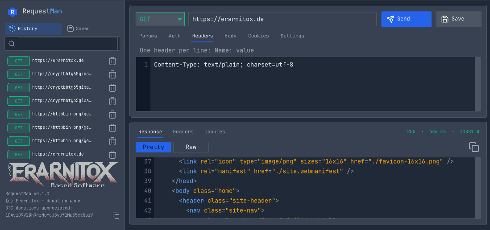

# RequestMan

Native cross-platform HTTP API client written in modern **C++23**.



## Features

- Request editor for GET/POST/PUT/PATCH/DELETE/HEAD/OPTIONS
- Query params, headers, body, cookies, auth, and request settings
- Response viewer with status, timing, size, pretty/raw views, and binary-safe transport
- Persistent saved requests (SQLite)
- Request history with retention limits
- Secret redaction in structured logs
- Async HTTP execution so the UI thread never blocks on the network
- Replaceable HTTP transport (`IHttpClient`, libcurl implementation included)
- Replaceable persistence (`I*Repository`, SQLite implementation included)

## Architecture

```
UI (raylib/raygui)
  -> AppController
       -> Domain (values + free functions)
       -> RequestExecutor (worker thread)
            -> IHttpClient (CurlHttpClient)
       -> IHistoryRepository / ISavedRequestRepository (SQLite)
```

Dependency direction is one-way: domain has no infrastructure types; UI does not speak SQL or libcurl.

## Dependencies

Managed with **CPM.cmake** where fetched; system packages preferred for curl/sqlite:

- CMake >= 4.0, Ninja
- C++23 compiler (GCC 14+/Clang 18+)
- libcurl (or **libcurl-impersonate** when `REQUESTMAN_WITH_CURL_IMPERSONATE=ON`, default on Linux)
- SQLite3
- Catch2 (tests)
- raylib + raygui (UI)

## Building

```bash
# Debug
cmake --preset debug
cmake --build --preset debug
ctest --preset debug
./build/requestman

# Release
cmake --preset release
cmake --build --preset release
./release/requestman
```

### UI shortcuts

- `Ctrl+Enter` — send request
- `Ctrl+H` — toggle History / Collections

## Releases

Pushing a `v*` or `V*` tag (for example `v0.1.0` or `V0.1.0`) runs GitHub Actions, builds a Linux x86_64 archive, and attaches it to the GitHub Release for that tag:

`requestman-<tag>-linux-x86_64.tar.gz`

Extract the archive and run `./requestman` from that directory. The executable loads `assets/` and the bundled libraries beside it, so leave that layout in place.

The archive includes libcurl-impersonate and SQLite. The host needs a desktop graphics stack (OpenGL and X11, and Wayland client libraries when the session uses Wayland) and glibc from Ubuntu 24.04 or newer.

The version string inside the app comes from `PROJECT_VERSION` in `CMakeLists.txt`. The archive name uses the git tag.

## Security

- TLS peer/host verification is enabled by default (toggleable in Settings)
- libcurl is restricted to `http`/`https` (including redirects)
- Proxy URLs are limited to `http`, `https`, `socks5`, and `socks5h`
- Header and cookie values that contain a line break are rejected
- Secrets are redacted in structured logs
- SQL uses parameterized statements only
- Oversized responses are truncated at a configurable byte limit (default 32 MiB)

## License

MIT

## Browser identity / TLS impersonation

Settings → **Browser Preset** selects a curl-impersonate target (for example Chrome on Windows 11) so TLS and HTTP/2 fingerprints match a real browser. User-Agent and optional client-hint headers can be overridden.

Real JA3/JA4 matching requires linking **lexiforest/curl-impersonate** (`REQUESTMAN_WITH_CURL_IMPERSONATE=ON`). Point CMake at a custom install with `-DCURL_IMPERSONATE_ROOT=...` if needed. Disable the option to fall back to stock libcurl (browser presets other than None then fail at send time).
